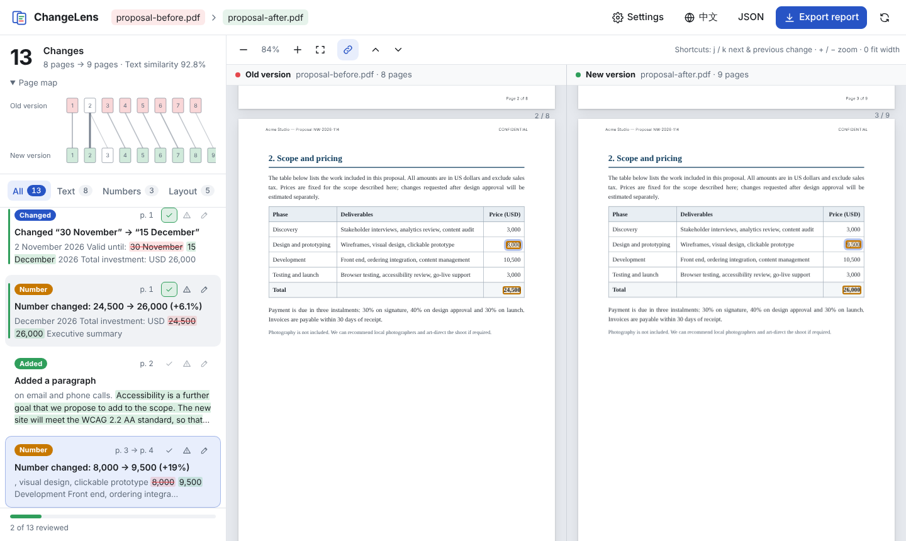
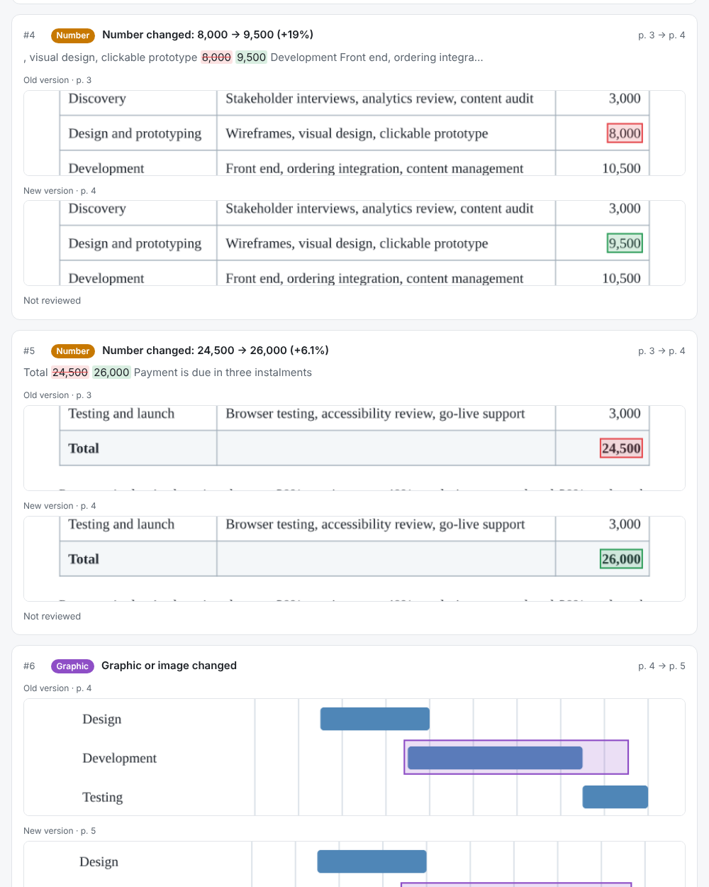

<p align="center">
  
</p>

<h1 align="center">ChangeLens</h1>

<p align="center">
  <b>See exactly what changed between two versions of a PDF.</b><br>
  Text, numbers and layout — clearly located, with irrelevant noise removed, in a report anyone can open.
</p>

<p align="center">
  <a href="https://ray0766.github.io/changelens/"><b>Open the web app</b></a> ·
  <a href="#command-line">CLI</a> ·
  <a href="#how-it-works">How it works</a> ·
  <a href="README.zh-CN.md">中文说明</a>
</p>

<p align="center">
  <a href="https://github.com/Ray0766/changelens/actions/workflows/ci.yml"></a>
  <a href="LICENSE"></a>
</p>



> “The price on page 3 went from 8,000 to 9,500; a paragraph is missing on page 6; the table on page 8 no longer fits on the page.”

That is the kind of answer ChangeLens gives you. Drop in the old and the new version of a document and get a plain-language list of what changed. Each change is highlighted in both versions, side by side, and the two views scroll together.

## Why another PDF diff?

Tools like [diff-pdf](https://github.com/vslavik/diff-pdf) compare page 1 with page 1, page 2 with page 2, and so on. That works until someone adds a paragraph near the start. Then every later page shifts, and every later page shows up as "different".

ChangeLens is built for the person who has to **review** the changes: a lawyer checking a contract, a buyer checking a quote, an editor checking proofs.

- **It is built for repagination.** Content is matched across the whole document, not page by page. An inserted paragraph is one change, not eight red pages. The page map shows how old pages correspond to new ones (old p. 3 → new p. 4).
- **It reduces noise without hiding it.** Running headers, footers and page numbers are recognised and ignored by default. So are re-flowed line breaks and hyphenation, ligatures, curly versus straight quotes, full-width versus half-width characters, and lines that only shift by a few points. Every ignored category is counted on screen and in the report, with a **Show** button. Pages without readable text are named, so "no differences" is never a blind all-clear.
- **It speaks plainly.** "Number changed: 8,000 → 9,500 (+19%)", "Number changed: 500 → −500 (sign changed)", "Number changed: 4% → 8% (+4 pp)", "Deleted a paragraph", "Moved and edited a paragraph" (with the edits inside it listed), "Added content that repeats p. 2 word for word", "“APPROVED” moved 106 mm to the right", "Content is cut off at the right edge of the page".
- **It separates text from layout.** Text edits (added, deleted, changed and moved text, and numbers) are listed apart from visual changes: charts and images, colour, bold or size, content overflowing the page.
- **It produces a report you can share.** One self-contained HTML file with before/after snippets for every change, your review marks (✓ / ⚠) and notes. It opens in any browser, prints cleanly, and contains no scripts.
- **It is private.** The web app runs entirely in your browser. Your files are never uploaded.

## Features

| | |
|---|---|
| Side-by-side viewer | Synchronised scrolling that follows matched content, not page numbers; change bars in the page margin; zoom; keyboard navigation (`j` / `k`); colour legend |
| Change list | Filter by *All / Text / Numbers / Layout*; each entry has a description, location (`p. 3 → p. 4`) and a context excerpt; can be hidden for a document-first view |
| Numbers | Amounts, prices, percentages and signs (`−500`, `(1,200)`, `−€62.40`, `１２，０００`) are detected, with the relative change, the change in percentage points for rates, or "sign changed"; several revised figures get one entry each |
| Paragraphs, moves, duplicates | Whole inserted / deleted / moved paragraphs are described as such; edits inside a moved paragraph are listed as their own changes; content repeated word for word says where it repeats |
| Formatting and position | Bold, italic, size and font changes of unchanged text (one entry when a font is replaced everywhere); unchanged lines that moved sideways |
| Graphics and colour | Pixel comparison of charts, images, lines, shading and text colour, with text masked out and each region aligned to where its text moved; strikethrough and underline added or removed; pages without text paired by position and look, or reported as added or removed; page size or orientation changes |
| Overflow | Text cut off at the page edge, or sticking out into the margin |
| Form fields | Values of PDF text and choice fields are compared as text and marked "(form field)"; check boxes and radio buttons are compared as graphics |
| Nothing hidden silently | Counts of ignored header/footer differences, minor shifts, renumbered list items and table header rows repeated at a page top (with **Show**); pages without a text layer, pages not compared visually, unreadable glyphs, form fields that could not be read as text, pages that are mostly new |
| Manual page pairing | Pair an old page with a new page by hand (page map or keyboard form) when automatic pairing is not possible, e.g. a chart page after an inserted page |
| Review | Mark each change as OK or needing attention and add notes; progress is saved locally |
| Export | HTML report (crops, review notes, file SHA-256, method and settings) and JSON |
| Languages | English and 简体中文 UI and reports; Chinese and Japanese text is compared character by character, Korean word by word (Chinese and Japanese are in the PDF test set; Korean has unit tests only) |

## Using it

### In the browser

Open **<https://ray0766.github.io/changelens/>**. Drop the old PDF on the left and the new one on the right, or try one of the built-in demos. To run it locally:

```bash
git clone https://github.com/Ray0766/changelens.git
```

```bash
cd changelens && npm install && npm run dev
```

The static build (`npm run build:web`, output in `dist/`) can be hosted anywhere, including an intranet server.

### Command line

```bash
npm install -g github:Ray0766/changelens
```

```bash
changelens contract-v1.pdf contract-v2.pdf -o review.html
```

```
contract-v1.pdf (8) → contract-v2.pdf (9)
13 changes — 8 text · 3 numbers · 5 layout
   1  Changed   Changed “30 November” → “15 December”  p. 1
   2  Number    Number changed: 24,500 → 26,000 (+6.1%)  p. 1
   3  Added     Added a paragraph  p. 2
   4  Number    Number changed: 8,000 → 9,500 (+19%)  p. 3 → p. 4
   …
→ review.html
```

| Option | |
|---|---|
| `-o, --out <file>` | Write the HTML review report |
| `--json <file>` | Write all changes as JSON |
| `--lang en\|zh` | Language of descriptions (default: from `$LANG`; `zh-CN`, `en_US` etc. are accepted) |
| `--no-visual` | Skip the graphics/colour comparison (faster) |
| `--no-format` | Don't report bold/size/font changes |
| `--include-furniture` | Also compare headers, footers and page numbers |
| `--ignore-case`, `--ignore-punctuation` | Looser text comparison |
| `--pair OLD:NEW` | Treat old page OLD and new page NEW as the same page (repeatable), e.g. for pages without text |
| `--fail-on-change` | Exit with code 1 if anything changed, or 3 if nothing changed in what was compared but something could not be compared (useful in CI) |

Exit codes: `0` done (with `--fail-on-change`: no differences and everything compared), `1` differences found (`--fail-on-change`), `2` error (bad option, unreadable PDF, or an output path that cannot be written or would overwrite an input), `3` no differences in what was compared, but some pages, characters or graphics were not compared (`--fail-on-change`). The JSON export (schema version 2) includes the tool version, whether graphics were compared, the notices and the coverage with 1-based page numbers.

The CLI needs Node.js 22.13 or newer. Page images for the report are rendered with [`@napi-rs/canvas`](https://github.com/Brooooooklyn/canvas), which is installed automatically as an optional dependency. Without it the CLI still compares text, but skips the graphics comparison and the report images.

<details>
<summary>Report example</summary>



</details>

## Evaluation

ChangeLens is scored on synthetic PDF pairs with known edits, against a text line diff (extract + `diff`) and a page-by-page pixel diff (the diff-pdf approach). Details and every number: [docs/EVALUATION.md](docs/EVALUATION.md).

The numbers that were **not tuned** are the first runs of held-out sets written by independent authors who did not see the engine:

| First run of a held-out set | ChangeLens found · extra | Text line diff | Pixel page diff |
|---|---|---|---|
| Round 2: 12 pairs, 53 edits, Chromium | 49 · 9 | 40 · 17 | 45 · 44 |
| Round 3: 12 pairs, 73 edits, Chromium, LibreOffice, reportlab | 55 · 38 | 57 · 57 | 73 · 38 |
| Round 4: 18 pairs, 119 edits, Office files via LibreOffice, 40–85-page and Japanese/Traditional Chinese documents, PDFs assembled with pypdf | 104 · 175 | 89 · 263 | 117 · 404 |

Round 2 was scored with the rules of that time. Round 4 uses the rules registered before its run. Its pixel diff "finds" 117 of 119 edits, but places only 97 of them on the right page.

In round 3, ChangeLens found fewer edits than the text line diff. Most of those misses were correct changes, reported narrower than the truth snippet ("7 → 6" for "For 7 → For 6"). The rest, and most of the extra items, were real problems:
- repeated table header rows reported as text;
- lines that changed column reported as moved;
- table rules on re-flowed pages reported as graphic changes;
- a Chinese rewrite split in two.

These were fixed afterwards.

In round 4, ChangeLens reported 116 of 119 edits, and the scorer credited 104 of them. It missed the three values of PDF form fields, which it did not read then, and it did not say so. Its main weakness was noise: 154 extra items on long, re-paginated and CJK documents. These were table header bands and rules that came and went with page breaks, automatically renumbered lists and clauses, and colour, strike or underline wrongly reported on glyphs that only moved.

These causes were fixed afterwards. Form field values are now compared. The new rules that hide noise were then probed adversarially, with real edits placed next to each hidden pattern. That found 17 cases of medium or high severity where a real edit was hidden. They were fixed too, so that a rule now hides an item only with evidence that it follows from a listed change. On the same 18 cases ChangeLens now finds 118 of 119 edits with 4 extra items. That is not a blind result. Details: [EVALUATION.md](docs/EVALUATION.md#round-4-after-fix-rounds-5-and-6-no-longer-held-out).

On all 31 pairs that are not blind (117 edits), ChangeLens finds and places every edit with no extra item:

| All 31 pairs, used for tuning and fixes | Found | On the right page | Extra items to read |
|---|---|---|---|
| ChangeLens | 117 / 117 | 117 / 117 | 0 |
| Text line diff | 89 / 117 | 89 / 117 | 56 |
| Page-by-page pixel diff | 117 / 117 | 106 / 117 | 117 |

The pixel diff "finds" an edit when it marks any region on the right page, without saying what changed. That table and the re-scored rounds 3 (73 / 73 found, 1 extra) and 4 (118 / 119 found, 4 extra) describe sets that were used for fixes, so they are not evidence of how ChangeLens does on new documents. They describe this test set, not PDFs in general.

## How it works

1. **Extraction.** [PDF.js](https://mozilla.github.io/pdf.js/) reads the text runs of every page with their position, size and real font name. Runs are split into words, with per-character widths estimated from standard font metrics. CJK text is split into single characters, and numbers like `8,000.50` stay whole.
2. **Structure.** Runs are grouped into lines and paragraphs. Words hyphenated at a line break are re-joined. Running headers, footers and page numbers are detected: a line counts if it repeats in the top or bottom margin on most pages, or if its number follows the page number. A number alone in the margin counts as a page number only if it is a small integer or roman numeral set apart from the body text, so a table row or an amount that ends a page is still compared.
3. **Document-level diff.** Both documents become one continuous word stream each, so page breaks no longer matter. The streams are diffed with *patience* anchoring on unique words, with Myers' O(ND) algorithm for small segments; the anchored result is kept unless it loses too many matches. When a long, heavily revised segment defeats the exact diff, unique words without a matching neighbour and then words that occur equally often on both sides are used as anchors; what still cannot be aligned is flagged in a notice. A semantic clean-up pass then removes coincidental one- or two-word matches inside rewritten passages, but never folds away structure a reader uses to locate edits: headings, row labels, or labels between revised figures.
4. **Interpretation.** The edit script is turned into changes: inserted, deleted or replaced words; numeric changes with their values; whole paragraphs; moves (a deleted and an inserted block whose words match ≥ 80 % in order; the two texts are then diffed, and edits inside the moved block are listed as their own changes); formatting changes of matched words; text crossing the page edge. Nearby insertions on consecutive lines, such as new table cells, are merged.
5. **Page map and scrolling.** Matched words give a monotonic set of anchors between the two documents. They produce the page correspondence (old p. 3 → new p. 4) and drive the synchronised scrolling.
6. **Visual comparison.** Matched page pairs are rendered and slightly blurred, so that thin lines drawn at different sub-pixel positions look alike. Text is masked out, because it has already been compared. Every region of the old page is compared with where its neighbouring text moved in the new page; rows whose nearest text went to another page are left to that page's comparison. Differences that one common offset of up to 4 pt explains are "minor shifts", hidden but counted. The rest are clustered into regions. Matched words are also checked for changes of colour or stroke weight, and intact lines for sideways moves.

Everything in `src/core` is plain TypeScript without DOM or Node dependencies, so the browser app and the CLI share exactly the same engine.

## Scope and limitations

This first version focuses on **text-based PDFs**. It has been tested with PDFs produced by Chromium (browser "Print to PDF"), LibreOffice (also Word, Excel and PowerPoint files rendered by LibreOffice) and reportlab, and with PDFs assembled with pypdf. Other producers (Microsoft Word's own PDF export, InDesign, LaTeX…) should work in the same way but are **untested**.

- **Scanned PDFs** (images of text) have no text layer and are not supported. ChangeLens says which pages have no text; OCR is on the roadmap.
- **Reading order** comes from the PDF content stream. This is right for typical generated documents. Producers that write text out of order can produce noisy diffs.
- **Word boxes** are estimated from the width of each text run, so highlights may be off by a few points with unusual fonts.
- **Fonts without a bold face.** When a font has no bold variant, PDF generators fake bold by stroking the glyphs. The visual check catches this only if the weight change is strong enough.
- **Small shifts.** Lines or graphics that move by 4 pt or less are listed only after **Show**.
- **Cut-off text.** Text that a smaller page box hides is listed as cut off, not as deleted, when the words around it kept their place. A word deleted beyond the new edge of an unchanged layout looks the same and is listed as cut off too. On a page whose text was scaled to fit other paper, nothing is taken for cut off.
- **Form fields.** Values of text and choice fields are compared as text. Check boxes and radio buttons are compared only as graphics. Password fields, rotated fields and values that cannot be read as text are counted in a notice and compared only as images.
- **Renumbering.** A list or clause number is hidden as automatic renumbering only when numbered items at the same level were added, removed or moved above it. A column of figures that starts at 1 and counts up by one can still be taken for row numbers.
- **Sub- and superscript.** A change only of script form ("CO2" → "CO₂", a raised "rd") is not reported.
- **Pages without text** (a chart, a scanned page) are paired automatically only from the pages around them. When that is not possible, ChangeLens says so, and you can pair the pages by hand: **Pair pages** in the page map, or `--pair OLD:NEW` in the CLI.
- **Speed.** On a 4-core Xeon VM (2.1 GHz), 8 → 9 pages take about 0.6 s for text and 5.5 s with the visual check; 24 pages take 0.8 s and about 12 s. Fix rounds 5 and 6 later added about 5–10 % to the visual stage, measured A/B on another VM (see [EVALUATION.md](docs/EVALUATION.md#performance)). The visual stage can be switched off with `--no-visual` or in Settings.
- **Very large pages.** Pages are rendered within a pixel budget. Pages larger than about 2A0 are not compared visually, and a notice names them.
- **Faint graphics.** Fills lighter than about #f9f9f9 (fewer than 6 levels from white) and hairlines fainter than about 12 levels are not detected. Faint graphics are only checked between matched lines of text.

## Roadmap

- [ ] Images (PNG/JPEG) and slide decks (PPTX via PDF export)
- [ ] OCR for scanned PDFs
- [ ] Multi-column reading-order reconstruction
- [ ] Pairing pages without text across larger reorderings (today: by position and coarse look between paired pages)
- [ ] Shareable report as a single PDF
- [ ] Published npm package (`npx changelens`)

Ideas and use cases are welcome. Please open an issue, ideally with a small synthetic sample pair.

## Development

```bash
npm install
```

```bash
npm run dev
```

| Script | |
|---|---|
| `npm run dev` | Web app with hot reload |
| `npm test` | Unit and end-to-end tests (Node's built-in test runner; no extra framework) |
| `npm run typecheck` | TypeScript |
| `npm run build` | Static web app in `dist/` and CLI in `dist-cli/` |
| `npm run cli -- a.pdf b.pdf` | Run the CLI from source |
| `npm run samples` | Regenerate the demo PDFs (needs Playwright's Chromium) |

```
src/core/     diff engine (environment-agnostic): tokenize, furniture, diff, compare,
              overflow, visual, describe, report, i18n
src/pdf/      PDF.js text extraction (shared)
src/web/      browser app: viewer, sidebar, export
src/node/     Node PDF loading and rendering
src/cli/      command-line interface
test/         node:test suites and fixture PDFs
```

Development requires Node.js 22.18+ (tests run TypeScript directly via type stripping). See [CONTRIBUTING.md](CONTRIBUTING.md).

## Contributor and agent guidance / 开发规范

Before implementing anything, read [AGENTS.md](AGENTS.md) and the [project quality brief](docs/QUALITY_BRIEF.md). They cover research, differentiation, design references and acceptance criteria. Decisions and evaluation evidence are recorded in [docs/DECISIONS.md](docs/DECISIONS.md) and [docs/EVALUATION.md](docs/EVALUATION.md).

后续开发（包括 Agent）请先阅读上述工作规范与项目 brief：先验证技术选择和核心亮点，再完成设计、实现与验收。

## Privacy

The web app is a static site. PDFs are read with the File API and processed in your browser, and nothing is sent anywhere. Review marks and notes are kept in your browser's local storage, keyed by a hash of the two files.

## Licence

[MIT](LICENSE). ChangeLens uses [PDF.js](https://github.com/mozilla/pdf.js) (Apache-2.0) and optionally [@napi-rs/canvas](https://github.com/Brooooooklyn/canvas) (MIT).
