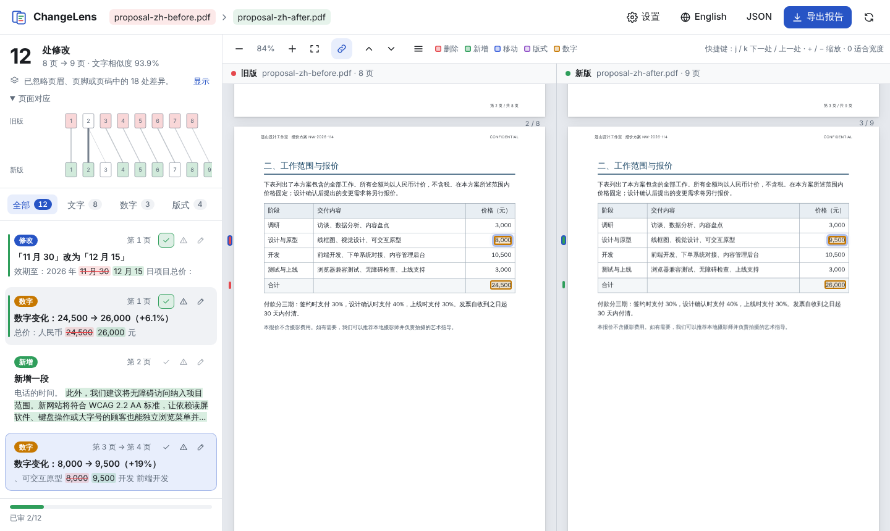

<p align="center">
  
</p>

<h1 align="center">ChangeLens</h1>

<p align="center">
  <b>把修改前后的 PDF 放进来，一眼看清文字、数字和版式改在哪里。</b><br>
  清晰定位、过滤无关差异，并生成任何人都能打开的审查报告。
</p>

<p align="center">
  <a href="https://ray0766.github.io/changelens/"><b>打开网页版</b></a> ·
  <a href="#命令行">命令行</a> ·
  <a href="#工作原理">工作原理</a> ·
  <a href="README.md">English</a>
</p>



> “第 3 页报价从 8,000 改成了 9,500；第 6 页少了一段；第 8 页表格超出了页面。”

这就是 ChangeLens 给出的答案。放入旧版和新版，你会得到一份用大白话写成的修改清单。每处修改都在左右两版中高亮显示，两侧同步滚动。

## 为什么还要一个 PDF 对比工具？

[diff-pdf](https://github.com/vslavik/diff-pdf) 这类工具逐页做像素比较：第 1 页对第 1 页，第 2 页对第 2 页。可一旦前面多了一段，后面的内容整体顺延，之后的每一页都会被标成"不同"。

ChangeLens 面向的是真正要**审查修改**的普通人：核对合同的法务、核对报价的采购、核对校样的编辑。

- **为重新分页而设计**：在整份文档范围内按内容匹配，而不是逐页比较。前面插入一段只算一处修改，不会让后面八页全部变红。页面对应图会显示旧版第 3 页对应新版第 4 页。重新分页仍可能留下少量条目，见[范围与限制](#范围与限制)。
- **减少无关差异，但不静默隐藏**：默认忽略页眉、页脚和页码（这些行上的表单字段值仍会逐页比较）。换行和断词重排、连字、中英文引号和全半角差异按相同文字处理，不算差异，也不计数。以下被忽略的差异会在界面和报告中注明数量：页眉页脚差异、几个点以内的线条移位、自动重新编号，以及仅因分页位置变化而出现或消失的页首重复表头行和页脚处的表格收尾线，均可「显示」；选择忽略大小写时，仅大小写不同的差异也会计数。在页脚画在正文之后的页面上（用 PyMuPDF 的修改测试过），PDF 编辑器改写后存放在页脚之后的文字，会按其在页面上的位置放回原处比较，并有说明注明涉及的页面。没有可读文字的页面会被点名，因此「没有发现差异」不会是盲目的结论。
- **说人话**："数字变化：8,000 → 9,500（+19%）"、"数字变化：500 → −500（正负号改变）"、"数字变化：4% → 8%（+4 个百分点）"、"删除了一段"、"移动并修改了一段"（段内修改另行列出）、"新增的内容与第 2 页完全重复"、"「APPROVED」向右移动了 106 毫米"、"新增图章（批注）：「FOR COMMENT」"、"内容超出页面右边缘，被截断"。
- **文字与版式分开看**：文字的增删改、段落移动和数字变化，与图形图片、颜色粗体字号、高亮、删除线和下划线批注、内容超出页面等视觉变化分开列出。
- **报告方便分享**：导出单个 HTML 文件，每处修改附修改前后截图，以及你的审查标记（✓ / ⚠）和备注。任何浏览器都能打开，也可直接打印，文件中不含脚本。
- **隐私**：网页版完全在浏览器本地运行，文件不会上传。

## 功能一览

| | |
|---|---|
| 左右对照浏览 | 按匹配内容（而非页码）同步滚动；缩放；键盘导航（`j` / `k`） |
| 修改清单 | 按"全部 / 文字 / 数字 / 版式"筛选，每条带说明、位置（`第 3 页 → 第 4 页`）和上下文摘录 |
| 数字 | 识别金额、价格、百分比和正负号（`−500`、`(1,200)`、`−€62.40`、`１２，０００`、`－1,200元`）的变化，给出变化幅度、比率的百分点变化或「正负号改变」；中日文中用年、月、日写的日期按日期比较，不带百分比；多个数字同时修改时逐个列出 |
| 段落级描述 | 整段新增、删除、移动时直接说明 |
| 移动 | 移动的段落只算一处"移动"，不会拆成一删一增；移动段落内部的修改单独列出并定位到两版 |
| 格式 | 内容不变但粗体、斜体、字号、字体发生变化，页脚画在正文之后的页面上 PDF 编辑器改写的文字也包括在内（用 PyMuPDF 的修改测试过） |
| 图形与颜色 | 遮住文字后做像素比较，并按文字移动的位置对齐，可发现图表、图片、线条、底纹和文字颜色的变化；新增或去掉的删除线、下划线；高亮、删除线和下划线批注按所覆盖的词列出，图章和文本框批注连同其文字列出（文字只占批注框约四分之一以下的除外）；没有文字的页面按位置和外观配对，配不上则报告为新增或删除的页面；页面尺寸或方向变化 |
| 位置与重复 | 内容不变但横向移动的行；与其他页完全重复的新增内容 |
| 不静默隐藏 | 注明被忽略的页眉页脚差异、轻微移位、自动重新编号的列表，以及随分页出现或消失的页首重复表头和表格收尾线（可「显示」）；无文字层的页面、未做视觉比较的页面、无法识别的字符、无法按文字读取的表单字段、大部分为新内容的页面、存放在页脚之后并按位置放回的文字、文件中的批注及其中未比较的部分、位于印章、水印或底色之下或旁边，或其上的线太细太浅而只能部分比较颜色、粗细、删除线和下划线的词 |
| 手动配对页面 | 无法自动配对时（如插页之后的纯图表页），可手动把旧版某页与新版某页配对 |
| 超出页面 | 文字被页面边缘截断，或伸进页边距 |
| 表单字段 | PDF 文本框和下拉框的值按文字比较，并标注「（表单字段）」；复选框和单选按钮按图形比较 |
| 审查 | 每处修改可标记"没问题 / 需要关注"并写备注，进度保存在本地 |
| 导出 | HTML 报告（含截图、审查备注、文件 SHA-256、比较方法与设置）与 JSON |
| 语言 | 中英文界面和报告；中文和日文按字比较，韩文按词比较（PDF 测试集含中文和日文；韩文仅有单元测试） |

## 使用

### 网页版

打开 **<https://ray0766.github.io/changelens/>**，左边放旧版、右边放新版，或者直接试试内置示例。本地运行：

```bash
git clone https://github.com/Ray0766/changelens.git
```

```bash
cd changelens && npm install && npm run dev
```

`npm run build:web` 生成的静态文件（`dist/`）可以部署到任何地方，包括公司内网。

### 命令行

```bash
npm install -g github:Ray0766/changelens
```

```bash
changelens 合同-v1.pdf 合同-v2.pdf --lang zh -o 审查报告.html
```

```
合同-v1.pdf (8) → 合同-v2.pdf (9)
12 处修改 — 文字 8 · 数字 3 · 版式 4
   1  修改  「11 月 30」改为「12 月 15」  第 1 页
   2  数字  数字变化：24,500 → 26,000（+6.1%）  第 1 页
   3  新增  新增一段  第 2 页
   4  数字  数字变化：8,000 → 9,500（+19%）  第 3 页 → 第 4 页
   …
```

常用参数：`-o` 导出 HTML 报告，`--json` 导出 JSON，`--pair 旧页:新页` 手动配对页面，`--lang zh` 中文描述，`--no-visual` 跳过图形比较，`--include-furniture` 同时比较页眉页脚，`--fail-on-change` 有差异时以退出码 1 结束，若已比较部分无差异但并非全部比较过（没有文字层的页面、无法识别的字符、无法作为文字读取的表单值、配对不确定的页面、只比较了一部分的词，或未比较的图形）则以 3 结束（适合 CI）；参数或文件错误、输出会覆盖输入时为 2。`--lang` 也接受 `zh-CN` 等写法。JSON 导出（第 2 版格式）包含工具版本、是否比较了图形、各项说明，以及以 1 开始的页码的覆盖情况，其中包括只比较了一部分的词（`partlyCompared`）和无法读取的表单值（`fieldsUnread`）。完整说明见 `changelens --help`。

命令行版需要 Node.js 22.13 或更高版本。报告截图通过可选依赖 [`@napi-rs/canvas`](https://github.com/Brooooooklyn/canvas) 渲染，会自动安装；如果没装上，仍可比较文字，只是跳过图形比较和报告截图。

## 工作原理

1. **提取**：用 [PDF.js](https://mozilla.github.io/pdf.js/) 读取每页的文字片段及其位置、字号和真实字体名，再按标准字体宽度估算每个字的位置，拆成词。中文和日文按单字拆分，`8,000.50` 这样的数字保持完整。
2. **结构**：把文字片段归并成行和段落；重新拼接行尾被连字符断开的单词；识别页眉、页脚和页码。规则是：在多数页面的上下边距区重复出现的行，或数字随页码递增的行。边距区里单独的数字只有在是较小的整数或罗马数字、并与正文分开时才算页码，因此落在页尾的表格行或金额仍会被比较。页眉页脚行上的表单字段值不进入词流，而是逐页在原位置比较；重新分页后多出来的页面上的值，只有在同一版本另一页的同一位置有相同的值，或同样的旧值 → 新值变化已在另一页列出时才隐藏，并计入被忽略的页眉页脚差异。
3. **全文比较**：把两份文档各自看成一条连续的词序列，页码边界就不再起作用。先用两边都只出现一次的词做 *patience* 锚定，小片段用 Myers O(ND) 算法；锚定结果只要没丢掉太多匹配就优先采用。若很长、改动很多的片段无法精确比较，先用没有相邻确认的唯一词、再用两边出现次数相同的词作锚点；仍无法对齐的部分会在说明中提示。最后做语义清理，去掉改写段落中偶然重合的一两个词，但不会把读者用来定位的结构合并掉：标题、表格行标签、修改过的数字之间的标签。
4. **解读**：把编辑结果转成修改项：新增、删除、替换；带数值的数字变化；整段增删；移动（删掉的块和新增的块按顺序有 ≥ 80% 的词相同；之后再比较两段文字，移动块内部的修改单独列出）；匹配词的格式变化；越出页面边缘的文字。相邻几行里的新增内容（例如表格新加的列）会合并成一处。
5. **页面对应与同步滚动**：匹配上的词构成两份文档之间单调的锚点，用来生成页面对应关系（旧版第 3 页 → 新版第 4 页），并驱动左右同步滚动。
6. **视觉比较**：渲染对应的页面并轻微模糊，使不同亚像素位置的细线看起来一致；遮住已比较过的文字，再把旧页的每个区域与其周围文字在新页中的位置对比；最近的文字已移到别的页的行，留给那一页比较。能用一个 4 pt 以内的统一偏移解释的差异算「轻微移位」，默认隐藏但计数；其余差异聚合成区域。对匹配上的词还会检查颜色或笔画粗细的变化，对完整未变的行检查横向移动。

`src/core` 是纯 TypeScript，不依赖 DOM 或 Node，网页版和命令行版共用同一个引擎。

## 效果评估

在已知真值的合成 PDF 上评估，对照基线为纯文本逐行 diff（提取文字后 `diff`）和逐页像素 diff（diff-pdf 的思路）。全部数字和规则见 [docs/EVALUATION.md](docs/EVALUATION.md)。

**没有经过调试的数字**，是由未看过引擎的独立作者编写的留出集的首次运行结果：

| 留出集首次运行 | ChangeLens 找到 · 多余 | 纯文本逐行 diff | 逐页像素 diff |
|---|---|---|---|
| 第 2 轮：12 对、53 处修改，Chromium | 49 · 9 | 40 · 17 | 45 · 44 |
| 第 3 轮：12 对、73 处修改，Chromium、LibreOffice、reportlab | 55 · 38 | 57 · 57 | 73 · 38 |
| 第 4 轮：18 对、119 处修改，经 LibreOffice 渲染的 Office 文件、40–85 页文档与日文和繁体中文文档、用 pypdf 拼装的 PDF | 104 · 175 | 89 · 263 | 117 · 404 |
| 第 5 轮：18 对、144 处修改，Typst、fpdf2 和 PyMuPDF 生成（按 PDF 编辑器的方式修改：涂黑后重新插入文字、批注、叠加层、页面操作），德文、法文、中文和日文 | 115 · 78 | 98 · 112 | 144 · 59 |

第 2 轮按当时的规则计分；第 4、5 轮按运行前登记的规则计分。像素 diff 在第 4 轮「找到」119 处中的 117 处，但只有 97 处页码正确；在第 5 轮找到 144 处中的全部 144 处，其中 132 处页码正确。

第 3 轮中 ChangeLens 找到的修改少于纯文本 diff。大部分漏计其实是正确的修改，只是报告的文字比真值片段窄（例如报告「7 → 6」，真值为「For 7 → For 6」）。其余漏计和大部分多余条目是真实问题：
- 跨页表格重复的表头被报为文字修改；
- 换栏的行被报为移动；
- 重排页面上的表格线被报为图形变化；
- 一处中文改写被拆成两条。

这些问题随后已修复。

第 4 轮中，ChangeLens 报告了 119 处修改中的 116 处，计分器认可其中 104 处。漏掉的是 3 个 PDF 表单字段的值：ChangeLens 当时不读取表单，也没有给出提示。主要问题是噪声：在长文档、重新分页的文档和中日文文档上有 154 条多余条目，包括：
- 跨页表头的底色和表格线随分页出现或消失；
- 自动重新编号的列表和条款号；
- 只是位置移动的字形被误报为颜色、删除线或下划线变化。

这些原因随后已修复，表单字段的值现在也会比较。之后又对新加的降噪规则做了对抗性探测：在每种被隐藏的模式旁边放入真实修改，结果发现 17 处中高严重度的问题，即真实修改被隐藏了。这些问题也已修复：现在只有在有证据表明某条目是已列出修改的连带结果时，规则才会把它隐藏。在同样的 18 对用例上，ChangeLens 现在找到全部 119 处，多余 3 条；这不是盲测结果。详见 [EVALUATION.md](docs/EVALUATION.md#round-4-after-fix-rounds-5-and-6-no-longer-held-out)。

第 5 轮首次运行中，ChangeLens 找到 144 处修改中的 115 处，少于像素 diff；多余条目 78 条，多于像素 diff 的 59 条。它在 Typst 用例中找到 51 处中的 48 处，在 fpdf2 用例中找到 48 处中的 44 处，但在 PyMuPDF 用例中只找到 45 处中的 23 处。这些 PDF 按 PDF 编辑器的方式修改：涂黑文字后插入新文字、批注、叠加层、页面操作、增量保存。每个漏报和多余条目都已分类，每条分类再由另一个代理复核（见 [EVALUATION.md](docs/EVALUATION.md#held-out-round-5-first-run)，逐条分析见 [eval/results-holdout5-analysis.md](eval/results-holdout5-analysis.md)）：
- **29 处漏报**：18 处以误导的形式列出，其中 16 处是因为 PyMuPDF 把改写的文字写在内容流中页脚之后。8 处是计分器没有认可的正确报告，2 处是在文档所述范围内的静默漏报（一条 0.4 pt 的黑色删除线和一条 0.73 pt 的亮绿色下划线），1 处既未检查也未提示（未改动的一行中，一个金额移到了另一列）。
- **78 条多余条目**：44 条是真值描述中写明的连带结果（发票中重新编号的行、分页位置变化处的表格线、跨页移动、翻转的斑马纹），22 条是真实修改被拆出的误导性片段，9 条是计分器无法认可的正确条目，3 条是误报。

**第 9 轮修复之后的第 5 轮（已不再留出）。** 第 9 轮修复随后用同样的 18 对用例处理了这些原因：改写的文字、紧贴下一格的行号、分页位置变化处的表格收尾线、中日文摘录和日期、细线和浅色线，以及文字标记批注。因此第 5 轮已不再是留出集，以下也不是盲测结果。在同样的用例上，ChangeLens 现在找到 144 处中的 139 处，多余 16 条（按登记规则为 133 处、17 条）：
- **Typst**：51 处中找到 48 处，多余 9 条（首次运行：19 条）。
- **fpdf2**：48 处中找到 46 处，多余 6 条（首次运行：找到 44 处，多余 36 条）。
- **PyMuPDF**：45 处全部找到，多余 1 条（首次运行：找到 23 处，多余 23 条）。

剩下的 5 处漏报中，4 处是计分器没有认可的正确报告，另一处是移到另一列的金额，这一点仍未检查（见「横向移动」）。16 条多余条目中，7 条是真实的连带结果（跨页移动、斑马纹、一个改写的词的字体变化），7 条是计分器无法认可的正确条目，2 条是误报。像素 diff 没有变化（找到 144 处，132 处页码正确，多余 59 条）。纯文本逐行 diff 现在为找到 110 处、多余 95 条（首次运行：98 处、112 条），因为它比较的是 ChangeLens 自身文本模型中的行，而这个模型现在已把改写的文字放回阅读顺序。十二个原因中，五个已修复（即本轮处理的全部原因），一个部分修复，四个未修复，两个只涉及计分；其余限制见[范围与限制](#范围与限制)。详见 [EVALUATION.md](docs/EVALUATION.md#held-out-round-5-after-fix-round-9-no-longer-held-out)。

在全部 31 对非盲测用例（117 处修改）上，ChangeLens 找到并定位了每一处修改，没有多余条目：

| 全部 31 对（已用于调试和修复） | 找到 | 页码正确 | 多余条目 |
|---|---|---|---|
| ChangeLens | 117 / 117 | 117 / 117 | 0 |
| 纯文本逐行 diff | 89 / 117 | 89 / 117 | 56 |
| 逐页像素 diff | 117 / 117 | 106 / 117 | 117 |

像素 diff 只要在正确的页面上标出任意区域就算「找到」，但不说明改了什么。上表、第 3 轮（找到 73 / 73，多余 1 条）和第 4 轮（找到 119 / 119，多余 3 条）修复后的重新计分，以及第 9 轮修复之后的第 5 轮，用的都是已用于修复的用例，不能证明 ChangeLens 在新文档上的表现，只说明这个测试集，不代表任意 PDF。

## 范围与限制

首版专注于**文字型 PDF**，已用 Chromium（浏览器「打印为 PDF」）、LibreOffice（包括由 LibreOffice 渲染的 Word、Excel、PowerPoint 文件）和 reportlab 生成的文件，以及用 pypdf 拼装的 PDF 测试。Typst、fpdf2 和 PyMuPDF 在一轮 18 对合成用例的盲测中试过（见[效果评估](#效果评估)），这些用例随后已用于修复。PDF 编辑器（如 PyMuPDF）涂黑后重新输入的文字，在页脚画在正文之后的页面上，现在会在原位置比较（见下文「阅读顺序」）。批注只用 PyMuPDF 2.1 和 pypdf 写入的测试过。Microsoft Word 自身导出的 PDF、WPS、InDesign、LaTeX、Acrobat 等批注工具生成的 PDF **尚未测试**。

- **扫描件**没有文字层，暂不支持。ChangeLens 会指出哪些页面没有文字，OCR 已列入计划。
- **阅读顺序**取自 PDF 内容流，一般生成的文档没有问题；个别不按顺序写入文字的生成器可能导致对比结果偏乱。PDF 编辑器涂黑文字后把新文字写在页面内容末尾（见于 PyMuPDF 的涂黑、插入文字和 HTML 文本框），以及浏览器把定位排版的文字最后写入时，这些文字排在页脚之后。页脚画在正文之后时，ChangeLens 会按位置把这些行放回原处比较，并在说明中注明；与修改一起重新输入的词，其格式变化在修改旁单独列出（显示为：「2027」字号 10.5 → 7.5 pt，字体 LiberationSerif → Helvetica）。其余情况：
  - 页脚先画（见于一个 reportlab 画布探测文件；LibreOffice Writer 最后画页脚，Microsoft Office 自身导出的 PDF 未测试），或某行没有明确位置（表格最后一行中重新输入的值、下方没有其他内容，或各行不齐的表格）时，文字仍按内容流顺序比较：修改列为一条删除加上一条位于页面末尾的新增，几个值可能合并成一条新增（显示为：新增「2,520.00 150.00」），也没有说明提示。
  - 位置在每个版本中各自判断。只在一个版本中放回的定位文字（徽标词、离段落一个词距的单行旁注、接近正文字号或上下叠放的脚注标记、紧挨标点的标记）可能列为删除后又新增，或被读进旁边段落的那一行。不会有内容被隐藏。
  - 紧挨被替换词重新输入的短语，列为一条新增加一条删除，而不是一处修改；在数字和紧接的单位之间重新输入会把它拆开（「45kg」→「45 kg」显示为文字修改）。
  - 在一页末尾新增的一行，紧接下一页开头被删除的文字时，仍可能列为一处改写。

  在第 5 轮盲测的首次运行中，29 处漏报里有 18 处、78 条多余条目里有 20 条由此造成。第 9 轮修复之后，该轮的 6 个 PyMuPDF 用例找到全部 45 处修改，多余 1 条（不是盲测结果）。
- **PDF 批注**：高亮、删除线和下划线批注从文件中读取，在所覆盖的词上列出（显示为：加了高亮（批注）：「……」）；图章和文本框批注连同其文字列出（显示为：新增图章（批注）：「FOR COMMENT」），文字只占批注框约四分之一以下的除外；说明中按类型统计文件中的批注。限制如下：
  - 这只在视觉比较中进行，而且只针对已比较页面上匹配的词。使用 `--no-visual`、在未做视觉比较的页面上，或在新增、删除的文字上，标记本身不会列出（说明仍会计数）；在重新输入且数值也改了的数字上新加高亮，只列出数字变化。
  - 批注中的文字（图章或批注自身的文字、弹出式评论）不逐词比较：较长批注中的小改动可能只显示「图形或图片有变化」；在探测中，在空白处移动的图章或文本框批注完全没有条目（显示「没有发现差异」，加 `--fail-on-change` 时退出码为 0，与第 9 轮修复之前相同），在其他位置移动的批注可能显示为删除加新增，或显示为有变化；批注之间互换的弹出文字没有提示。手写墨迹、形状、线条等其他类型只按图像比较。文字只占批注框约四分之一以下的批注，新增或修改时只显示「新增了图形或图片」或「图形或图片有变化」，不带其文字。已拼合进页面的批注不会产生批注条目。
  - 文字标记批注下方页面内容中的记号只能部分看到：同类同色的删除线或下划线，或与下划线批注相接的线，不会与批注分开列出；删除线批注下新加的删除线不会报告；删除线批注下的下划线显示为「文字颜色或粗细有变化」；高亮下改色的小于 2 × 2 pt 的图形不会报告；不透明的高亮下，被底色遮住的颜色变化看不到。
  - 只用 PyMuPDF 2.1 和 pypdf 写入的批注测试过。
- **词框位置**根据文字片段的整体宽度估算，遇到特殊字体时高亮可能有几个点的偏差。
- **没有粗体字形的字体**（很多中文字体如此）在 PDF 中用描边模拟粗体，只有粗细变化足够明显时才能被视觉检查发现。同时填充和描边绘制的文字只在区分列表编号时算作粗体；描边的增减交给视觉检查。
- **被页面边缘截断的文字**：页面框变小后看不见的文字，只要它周围的词位置不变，就列为「内容超出页面……被截断」，而不是删除。版式不变、删除的词又正好位于新边缘之外时，两者看起来完全一样，也会列为截断；如果同一行的数字改短了，而删除的词按新位置本应落在页面内，则列为删除。若页面文字为适应其他纸张而缩放，则不会当作截断。
- **轻微移位**：移动 4 pt 以内的线条或图形默认不列出，点「显示」才会出现。
- **删除线、下划线和小记号**：这些是在每个词的字形周围的像素里找的，因此取决于估算的字形位置：
  - 词框与字形偏离几个点时（见于 Carlito 字体和字号较小的 LibreOffice 文字），单个字符或数字上的删除线或下划线可能漏掉；
  - 用描边模拟粗体的中日文文字中，两个字的词上的删除线可能只在第一个字上找到；
  - 斜着延伸、一两个点内接上同色且同斜度图形的删除线，算作那个图形的笔画，只列出该图形。斜度 10° 以上、划过一个短语的单条笔画不当作删除线（不列出，也不计数）；超出短数字 10 pt 以上的陡斜笔画只计入「只比较了一部分」（第 9 轮修复之前的引擎列为「加了删除线」）；
  - 线条按它与纸色的色差来衡量（在高亮这类浅而饱和的底色上按亮度）。跨过相邻几个词的细线或浅色线会列出：中蓝（#2050c0）和绿色（#008000）0.8 pt、0.73 pt 的 #00ff00 下划线、所在行移动了的 0.4 pt 黑色细条。只在一个词上的这类线，可能计入「只比较了一部分」的警告而不列出（灰色 #808080 0.8 pt 和 1.5 pt、只有一个词的表格单元格上的 0.4 pt 细条）。仍然只部分检出或漏掉的：重排偏移不到一个像素后的灰色删除线（有的列出，有的计数，有的漏掉）；中等饱和色粗体标题上的灰色细删除线（计数，而第 9 轮修复之前的引擎会列出；在 #70ad47 上重排之后则漏掉）；带框线表格单元格中 12 px 粗体文字上的灰色细删除线（漏掉）；红色粗体文字上的灰色删除线（列为颜色变化）；亮绿色高亮底色上的红色细删除线（漏掉）。在探测中，黑色、深蓝、纯蓝、深灰、红色或与文字同色的删除线和下划线都找到了；
  - 粗体、斜体或字号有变化的词，其颜色或高亮变化不会列出；
  - 约 2.5 pt 以下的圆点、画在较长单词首字母上的小记号（约 5 pt），以及由虚线改为实线的细线（0.75 pt）都检测不到。
- **水印、印章和底色**：印章、印鉴、水印或底色压在词上或垫在词下时，词的颜色、粗细、删除线和下划线在覆盖物的墨迹之外比较。两者无法区分且该处像素有差异时，这个词会计入警告（“只比较了一部分”，附页码和示例词），结果也不算完整比较：`--fail-on-change` 以退出码 3 结束。以下变化只体现在这个计数里，不单独列出：
  - 两版都画在文字前面的水印或图片印章下的删除线或颜色变化（印章不透明度约 35% 及以下时会列出）；
  - 画在文字前面的半透明水印或印章字母下，词变浅、变灰或变粗（变成红色或蓝色会列出）；
  - 没有移动的半透明印章下，数字上的删除线。

  黑色文字上的灰色或黑色图片印章无法与字形区分，其下的变化可能漏掉，也不计数。跨几行文字绘制、圆环大多落在词与词之间的矢量印鉴，可能只在一个词上产生颜色条目而没有图形条目，圆环下的删除线也找不到。词旁边的图形有变化时，如果词框在两版中的深浅相差不到十分之一，这个词照常判断而不计数，因此那里很淡的记号也不会计数。计数中也可能包含没有问题的词，例如插入一行后重新排列的斑马纹表格；这时随行翻转的底纹会列为图形变化，移到色带上的短词可能被误报为加了下划线。移动或改色的水印，或跨行绘制的倾斜印章边框，仍可能在未改动的词上产生少量误报的颜色、删除线或下划线条目。PDF 编辑器在未改动的高亮批注下重新输入、内容未变的中日文日期，可能误报「文字颜色或粗细有变化」。
- **页眉页脚上的记号**：页眉页脚文字上的删除线、高亮或记号计入被忽略的页眉页脚差异（可「显示」），不单独列出；沿横线绘制的页眉行上的删除线可能漏掉。使用 `--include-furniture`（或在设置中关闭「忽略页眉、页脚和页码」）可把这些行当作正文比较。
- **表单字段**：文本框和下拉框的值按文字比较，旋转 90° 整数倍的字段也是如此；同一个值在字段中转向另一方向时，列为方向变化（“方向 从下到上 → 从上到下”）；复选框和单选按钮只按图形比较；密码框、旋转其他角度的字段和无法作为文字读取的值会在说明中计数，只按图像比较。自动字号的值只有在内容相同时才比较字号，只有字段框大小变化不到十分之一时才比较粗细（框变了，阅读器会重新缩放值）。拼合表单时保留了控件的，每个值会画两次，此时粗细变化不到约 30% 检测不到，颜色变化和更明显的粗细变化仍能找到。新版中改为单行绘制的多行字段可能产生误报的下划线和颜色条目。表单字体按 PDF.js 绘制字段的方式确定：表单资源中缺少的字体按 Helvetica 处理。页眉或页脚中的值改变且新增了页面时，该修改注明“共 N 处”，只计配对的页面；新增页面上的那份只计数，不单独列出。
- **重新编号**：只有在同一层级、位于其上方的带编号条目被增加、删除或移动时，列表或条款编号才会作为自动重新编号隐藏。位于第一列、从 1 开始逐一递增、上方没有数量类表头（Qty、Menge、Stück 等；「Count」「Nb」「Uds」不算）的一列数字，仍可能被当成行号，紧贴下一格时也是如此：其修改不再带百分比，上方新增的行能解释这一偏移时，会计为重新编号而不列出。接着上方步骤编号的标题（步骤“1.”“2.”之后的标题“3.”），或排版与步骤相同的标题（PDF 中未实际绘制的粗体），会被当作同一列表；编号为“2.”的标题或条目下方、行首为 2.1–2.4 等数值的一列会被当作其子条款。在这些位置手工改动的编号可能被计为重新编号（在说明中计数，可「显示」），而不是单独列出。反过来的情况也有：表格中的行号只有在至少三行的编号后都留有明显间隙时才会被识别。与下一格距离不到约 0.4 个字宽、不足三行，或最窄的间隙是列间距的行（见于中日文风格的表格）不会被识别，插入一行后，每个重新编号的行都会列为带百分比的数字变化。手工输入的行号会打断这一列：其后正确重新编号的行会被列出（不带百分比），位于这一列上方的则保留百分比（「10 → 1（-90%）」）。
- **数字**：只有数字本身带 % 时才给出百分点；写成「4 per cent」的比率或「Change (%)」列中的数字给出的是相对变化。两个值都是负数时，相对变化按绝对值计算（−1.8 → −2.6 显示为「+44%」）。不是金额的数字也会带百分比，例如日期中的日（11 月 30 日 → 18 日显示为「30 → 18（-40%）」）或账号的末几位。前置的 △、后置的负号（「43.30-」）和 DR/CR 不被当作正负号，所以以这种方式改变正负的余额不会标出「正负号改变」；用文字表示的正负（「en notre faveur」→「en votre faveur」）给出的是相对变化（「43.30 → 127.50（+194%）」）。中日文中用年、月、日写的日期，在月与年或日写在一起、各部分紧挨着时，按一个日期比较，不带百分比。单独的月、年或日（6月、2026年、每月1日）、两位数年份、汉字数字日期，或分在几个表格单元格中、在短行后折行的日期，会逐个数字读取（带百分比）或作为文字比较；相距约 1 个字宽以内的相邻单元格可能被读成一个日期。紧跟在中日文字符后的全角负号读作该数字的正负号，但在四个字以上的单位之后（「3个工作日－5个工作日」）或在表、図、图、圖、式、第以外的引用词之后的范围连接号，也会被读作负号；而前面三个字以内有数字的真正负号（「2023年同比－5%」）则读不出正负号，因此给出的方向可能是错的（「5% → 6%（+1 个百分点）」）。
- **重新分页**仍可能留下条目：
  - 分页位置变化时，表格片段末尾的收尾横线，在另一版本同一页上用相同的线结束同一张表格时，与页首重复的表头一起计数（可「显示」）。画得像这种收尾线的东西都会一起计数而不列出：分页前最后一行下手工画的线、略微加粗（不到约四分之一）或换了灰度的收尾线、沿着它的淡线，或紧挨其下的浅灰短划。线不相符，或分页前最后一格被修改时，这条线会列出；
  - 跟随引用标记移到下一页的脚注、越过脚注移到上一页的段落，以及越过分页、上方是只在后续页面出现的页眉的表格行，会列为移动。

  第 5 轮首次运行中，一份 37 页报告开头的一处插入产生了 11 条这样的条目；第 9 轮修复之后为 1 条（跟随引用标记移到下一页的脚注）。该用例的另一条多报是下文「修改描述与摘录」中误报为「移动并修改」的脚注。
- **横向移动**只按整行检查。在其余内容不变的一行中，一个值移到另一列（例如从「Débit」移到「Crédit」，即借贷方向反转）不会列出，也没有说明提示这一点未检查。几行组成的块横向移动时，每行各列一条。
- **修改描述与摘录**：
  - 摘录的上下文取自新版（与重新输入的文字合并的修改则取自旧版），因此在修改的词旁边可能显示另一版的词；
  - 围绕一个未改动的短语改写的句子，可能列为两条相邻的修改；
  - 中日文摘录在修改两侧最多各显示 18 个字，只在句末停止，不在其他边界停止，因此在表单和双语表格中可能延伸到相邻的字段或单元格，或从词的中间开始；
  - 在两端对齐的行上修改过的脚注，即使没有移动，也可能列为「移动并修改」；
  - 用 /Rotate 旋转的页面描述为「页面尺寸变化：595 × 842 pt → 842 × 595 pt」，而不是旋转；
  - 只有重复内容本身是一处单独的修改时，才会注明「完全重复」：紧挨新页面插入的重复页会和新页面一起列为一处新增，不带「完全重复」这条标注。
- **上下标**：仅上下标形式的变化（如「CO2」→「CO₂」、上标的「rd」）不会作为上下标变化指出。读出来是相同字符的上标数字不产生条目；在 reportlab 生成的文件中，同样的变化被列为误导的文字修改（显示为：「CO2」改为「CO」，另加 新增「2」）。
- **没有文字的页面**（图表页、扫描页）只能根据前后页面自动配对；配不上时会明确提示，你可以手动配对：在页面对应图中点「手动配对页面」，或在命令行使用 `--pair 旧页:新页`。
- **速度**：在 4 核 Xeon 虚拟机（2.1 GHz）上，8 → 9 页文字比较约 0.6 秒、含视觉比较约 6.2 秒；24 页分别约 0.8 秒和 13.2 秒。第 9 轮修复使视觉比较慢了约 5–7%，为同一台空闲虚拟机上的对照测量。第 8 轮修复曾使其慢约 12–15%；带大幅倾斜水印的页面，耗时约为之前的 1.7 倍（一份 34 页的备忘录：37.4 秒，之前 22.4 秒；此后未重新测量）。见 [EVALUATION.md](docs/EVALUATION.md#performance)。可在设置中关闭视觉比较，或使用 `--no-visual`。
- **超大页面**：页面按像素预算渲染，大于约 2A0 的页面不做视觉比较，并会在说明中列出。
- **很淡的图形**：比约 #f9f9f9 更浅的底纹（与白色相差不到 6 级）和淡于约 12 级的细线无法检出；淡色图形只在已匹配的文字行之间检查。紧贴着词画的浅色高亮（画在页面内容中；高亮批注会作为批注列出）落在文字范围内，相差约 12 级起会在该词上列为「文字颜色或粗细有变化」。相差不到约 40 级时，以下情况不会列出：行与行相接的整段高亮的中间部分，整行色带改了色，另一版在约两行范围内有同色的色带、面板或斑马纹，同一行上有同色图形发生变化，或词周围约 3 pt 内有任何图形变化。整行色带改色幅度更大时（灰色改为橙色，蓝色通道相差 66 级），未改动的黑色文字上出现了这条条目，图形条目也另行列出。

## 路线图

- [ ] 图片（PNG/JPEG）与演示稿（PPTX，经 PDF 导出）
- [ ] 扫描件 OCR
- [ ] 多栏排版的阅读顺序重建
- [ ] 在更大幅度的页面重排中配对没有文字的页面（目前：在已配对页面之间按位置和粗略外观配对）
- [ ] 报告导出为单个 PDF
- [ ] 发布 npm 包（`npx changelens`）

欢迎通过 Issues 提供具体使用场景、期望流程或可复现样例。请使用虚构或可公开分享的样例文件。

## 开发

```bash
npm install
```

```bash
npm run dev
```

`npm test` 运行测试（使用 Node 内置测试框架），`npm run build` 构建网页版（`dist/`）和命令行版（`dist-cli/`），`npm run samples` 重新生成示例 PDF。开发需要 Node.js 22.18+。详见 [CONTRIBUTING.md](CONTRIBUTING.md)。

## 许可证

[MIT](LICENSE)。使用了 [PDF.js](https://github.com/mozilla/pdf.js)（Apache-2.0），可选使用 [@napi-rs/canvas](https://github.com/Brooooooklyn/canvas)（MIT）。
